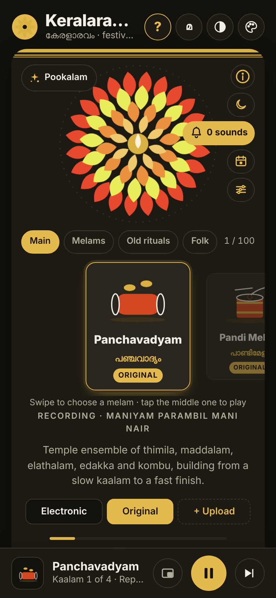
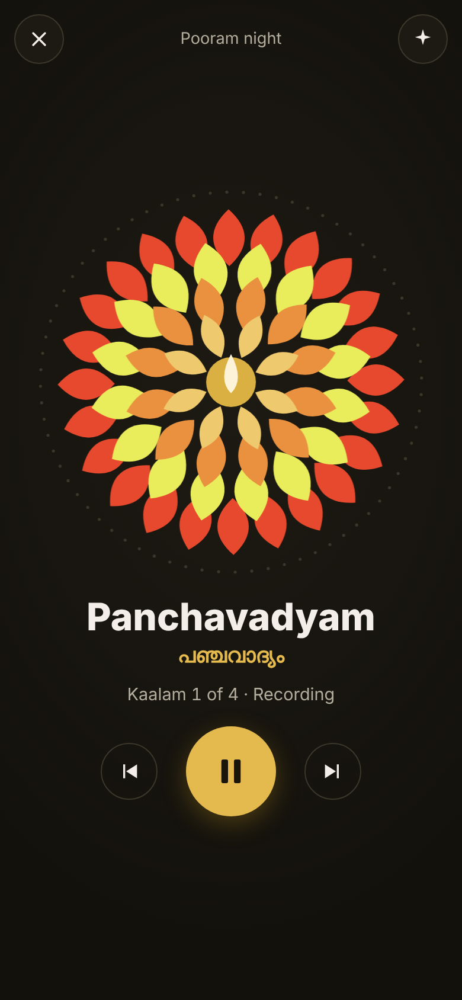
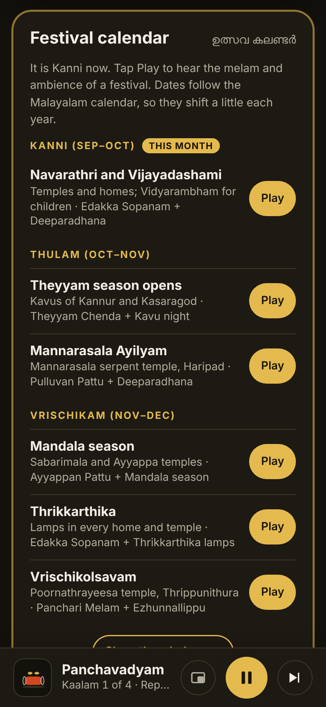
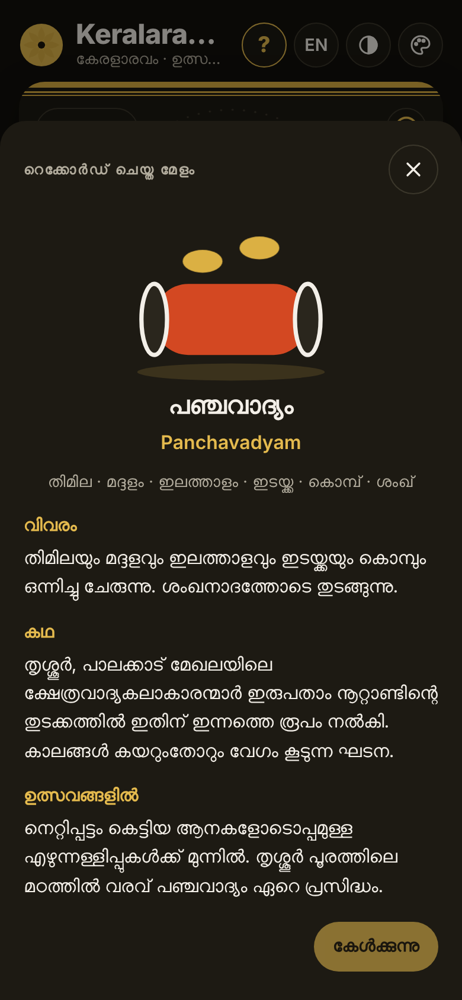
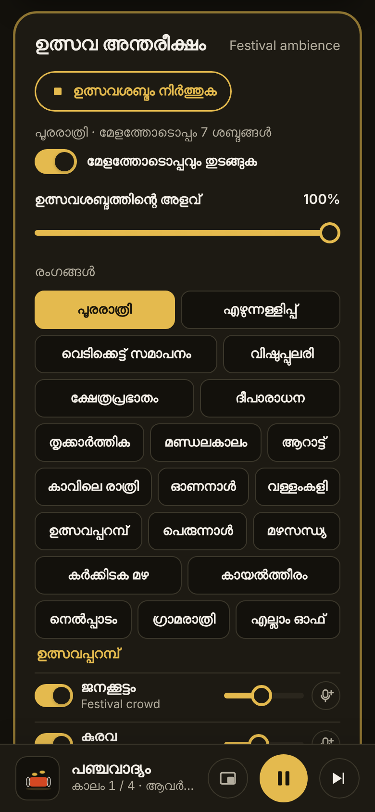

# Keralaravam · കേരളാരവം

**Version 2.0**

**Kerala festival sounds in your pocket.** Keralaravam is a free web app (PWA) for the sound of a Kerala festival: Panchavadyam, Pandi and Panchari Melam, Thayambaka and 100 melams and temple arts in all, with festival ambience, a Malayalam-calendar festival guide, practice tools and a sleep timer. It works offline once installed, in English and Malayalam.

> കേരളത്തിലെ ഉത്സവത്തിന്റെ ശബ്ദം നിങ്ങളുടെ ഫോണിൽ: പഞ്ചവാദ്യം, പാണ്ടി-പഞ്ചാരി മേളങ്ങൾ, തായമ്പക തുടങ്ങി 100 മേളങ്ങളും ക്ഷേത്രകലകളും, ഉത്സവ അന്തരീക്ഷവും ഉത്സവ കലണ്ടറും.

**Live app:** `https://YOUR-USERNAME.github.io/keralaravam/` (replace after you switch on GitHub Pages, see below)

<table>
  <tr>
    <td></td>
    <td></td>
    <td></td>
    <td></td>
    <td></td>
  </tr>
  <tr>
    <td align="center">Player</td><td align="center">Festival screen</td><td align="center">Festival calendar</td><td align="center">മലയാളം</td><td align="center">Ambience</td>
  </tr>
</table>

## Features

**Melams**
- 100 melams and temple arts in groups: Main, Melams, Old rituals, Folk, Stage arts, Onam, Very old arts and Utsavam moments.
- Nine play real recordings split into four kaalams (slow to fast): Panchavadyam, Pandi Melam, Panchari Melam, Thayambaka, Keli, Chempada, Adantha, Anchadantha and Edakka Sopanam. The rest play an electronic version until you add a recording.
- Swipe carousel with animated icons, ★ favourites, and an ⓘ page for every melam (About, Story, At festivals) in English and Malayalam.
- Kaalam build, hold one kaalam, "Repeat this kaalam", festival playlist, tempo and per-instrument mix.

**YouTube originals and videos (new in 2.0)**
- Every melam's sound switch can offer **Electronic**, **Original**, **YouTube** and **+ Upload original**. Where a melam has no built-in or uploaded recording, **Original** plays its YouTube audio (a moving spectrum, the credit, and a seek slider with elapsed and total time). **YouTube** plays the video itself.
- A **Watch** section in each melam's ⓘ page, a video button after My mixes and a video button on each melam card.
- Built-in links for 87 melams (153 videos), each credited with the title and channel from YouTube.
- Add your own links in **Your YouTube videos** and **Your YouTube audios** (any melam), with titles and credits fetched from YouTube. Each link can be verified, removed, and restored if it was a built-in one.
- Videos and audio need internet. Embedding is blocked by some uploaders, which Verify will report.

**Your own recordings**
- Upload a file or record live. The app analyses the whole melam, finds four kaalams, cuts seamless loops, evens the volume and compresses to MP3, all on the phone.
- Save as Original (replacing the built-in recording) or as My upload.

**Festival ambience**
- 21 sounds generated in the app (crowd, temple bells, conch, chengila, vedikkettu, amittu, elephants, kurava, rain, frogs, palm breeze, temple pond…) and 19 one-tap scenes such as Pooram night, Vishu morning and Deeparadhana.
- Play ambience on its own or with a melam, and swap any sound for a real recording you upload (**Upload original**).
- **YouTube originals:** 19 of the 21 sounds have a built-in YouTube recording (34 links). Switch any sound to its YouTube original with the YouTube button, and manage the links in **Festival ambience originals (YouTube)**.

**More**
- Festival calendar by Malayalam month, with one-tap play of each festival's melam and ambience.
- Practice: slow a recorded kaalam to 50–90% without changing its pitch; click track and big beat counter for electronic melams.
- Sleep routine with gentle fade-out, wake-up with Temple dawn.
- My mixes, the Festival screen (full screen, for a TV or function), fifteen visualiser animations (Pookalam, Nilavilakku, Chenda ripples, Kolam, Nettipattam, Vedikkettu, Muthukuda, Kayal waves, Theyyam crown, Lotus, Sun rays, Peacock feather, Karthika deepam, Monsoon rain, Night sky) plus Auto, six colour skins, light and dark themes.
- Lock-screen controls, a floating mini window and "Try next" suggestions.
- Backup and restore of uploads, mixes, your YouTube links and settings to a .zip file.
- A **Delete all my uploaded recordings** button in Your recordings.
- Built-in "How to use" guide (the ? button) and About page (tap the logo).

## Put it online with GitHub Pages (free)

1. Create a new **public** repository on GitHub, for example `keralaravam`.
2. Upload everything in this folder to the repository root, so `index.html` sits at the top level, not inside another folder.
3. In the repository go to **Settings → Pages**. Under **Build and deployment**, choose **Deploy from a branch**, branch **main**, folder **/ (root)**, then **Save**.
4. After a minute or two the site is live at `https://YOUR-USERNAME.github.io/keralaravam/`. Put that link at the top of this README.

GitHub Pages serves the site over HTTPS, which is what lets phones install it as an app and play offline.

## Install on a phone

- **Android (Chrome):** open the site, then tap **Install** in the app's top bar or use the browser menu **⋮ → Install app**.
- **iPhone (Safari):** tap **Share → Add to Home Screen**.

Once installed, the app opens from the home screen and works without internet. Live recording and the wake-up alarm work best in the installed app.

## Run it on your computer

```bash
python3 -m http.server 8000
```

Then open http://localhost:8000. A local server is needed because the service worker and audio files don't load from `file://`.

## Project structure

```
index.html             the whole app (HTML, CSS and JS in one file)
manifest.webmanifest   PWA manifest (name, icons, colours)
sw.js                  service worker: offline cache
audio/                 built-in recordings, each kaalam a beat-matched loop (MP3)
icons/                 app icons (192, 512, maskable, Apple touch, favicon)
vendor/lame.min.js     lamejs MP3 encoder, used to compress uploads on the phone
docs/screenshots/      images used in this README
dev/                   editable source and build script
  app.html             source of index.html
  head.html            the <head> tags added for the installable version
  loops.json           loop points of the built-in recordings
  videos.json          built-in YouTube links per melam (id, title, channel credit)
  ambvideos.json       built-in YouTube links per festival ambience sound
  info.py              melam info texts (English and Malayalam), for reference
  build.py             rebuilds index.html from app.html, loops.json and the two video files
.nojekyll              tells GitHub Pages to serve files exactly as they are
```

## Making changes

1. Edit `dev/app.html`.
2. Run `python3 dev/build.py` from the repository root to rebuild `index.html`.
3. Open `sw.js` and bump the cache name, for example `keralaravam-v67` → `keralaravam-v68`. Without this, phones that already installed the app keep the old version.
4. Commit and push. GitHub Pages updates within a few minutes.

To add or change a built-in YouTube link, edit `dev/videos.json` (melams) or `dev/ambvideos.json` (ambience sounds). Each entry is `{"v": "<11-character video ID>", "t": "<title>", "c": "<channel>"}`, keyed by the melam or sound id. In the app, **Verify** (in the Your YouTube panels) checks that a link still works and that its owner allows embedding.

To add or replace a built-in recording, put the MP3 in `audio/`, add its loop start and length to `dev/loops.json`, list it in `RECDEF` inside `dev/app.html`, and add the file to the `SHELL` list in `sw.js`.

## Credits

- **Created by Sooraj Mavelikkara** · soorajmavelikkara@gmail.com
- **Recordings:** Panchavadyam by Maniyam Parambil Mani Nair; Panchari Melam and Chempada Melam by Cheranellur Sankarankutty Marar; Pandi Melam by Pariyanampatta Melam 2024; Keli by Young Mahadev Raja Parakatav & Team; Edakka Sopanam: "Minnum Ponnin Chilambum"; Thayambaka, Adantha and Anchadantha from single performances. All recordings remain the property of their artists and rights holders.
- **YouTube videos and audio:** linked and played through YouTube's own embedded player. Each video's title and channel credit come from YouTube and are shown in the app. The videos belong to their uploaders. The app does not copy or store them, and links can stop working if an uploader removes a video or turns off embedding.
- **lamejs** MP3 encoder (LGPL), see `vendor/lamejs-LICENSE`.
- Festival ambience, electronic versions, animations and icons are made in the app, except the YouTube originals above.

## License

No license has been chosen yet. Until a `LICENSE` file is added, the code is "all rights reserved" by default. If you want others to reuse the code, add a license such as MIT from GitHub's **Add file → Create new file → LICENSE → Choose a license template**. Such a license would cover the code only, not the recordings in `audio/` or the linked YouTube videos.
